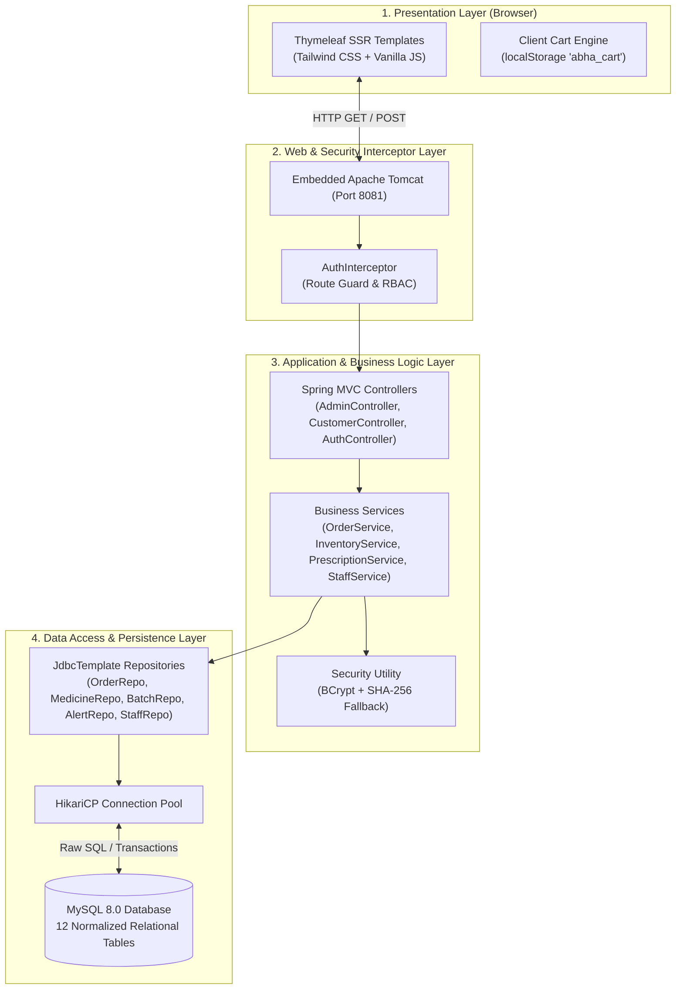
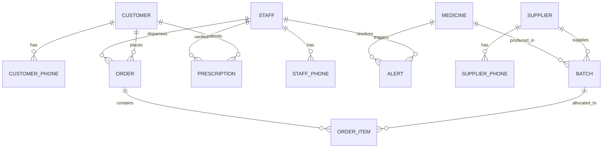

# Abha Pharmacy — Comprehensive System Architecture & Technical Report

> **Project Name**: Abha Pharmacy Digital Transformation Platform  
> **Course / Academic Context**: CSE302: Database Management Systems, IIT BHU  
> **Architecture Paradigm**: Multi-Tier MVC with Pure JDBC/Relational Persistence  
> **Technology Stack**: Spring Boot 3.1, Java 17, Thymeleaf 3.1, Tailwind CSS, HikariCP, MySQL 8.0  

---

## 1. Executive Summary

**Abha Pharmacy** is a full-stack, enterprise-grade healthcare management application designed to bridge physical pharmacy retail operations (POS counter dispensing) with modern patient self-service e-commerce. Built strictly to satisfy the core principles of database management systems (DBMS), the platform eschews black-box ORM frameworks (like Hibernate/JPA) in favor of explicit, auditable SQL executed through Spring's `JdbcTemplate`.

The system incorporates rigorous Indian pharmaceutical regulatory standards, including:
- **First-Expiry-First-Out (FEFO)** batch-level inventory dispensation.
- **Schedule H & H1 Prescription Register** audit trails.
- **Role-Based Access Control (RBAC)** distinguishing Executive Owners from Registered Pharmacists.
- **1NF / 2NF / 3NF Normalized Relational Schema** with composite keys and foreign-key integrity.

---

## 2. High-Level System Architecture

The application is structured into four clearly separated layers, communicating through strongly typed interfaces and data transfer models.



---

## 3. Frontend Architecture

The frontend is constructed using a **Server-Side Rendered (SSR)** approach augmented by lightweight, reactive client-side JavaScript.

### 3.1 Technology Stack
- **Template Engine**: Thymeleaf 3.1 (`org.thymeleaf:thymeleaf-spring6`)
- **Styling**: Tailwind CSS (Utility-first CSS configured with customized clinical design tokens)
- **Typography & Icons**: Google Fonts (*Plus Jakarta Sans*, *Inter*, *JetBrains Mono*) and Google *Material Symbols Outlined*
- **Client Scripting**: Vanilla JavaScript (Zero external bulky frontend frameworks like React or Angular, ensuring instant page loading and 100% SEO/crawler friendliness)

### 3.2 Modular Component Hierarchy
Templates are organized modularly under `src/main/resources/templates`:
```
templates/
├── index.html                           # Public landing page & clinical portal
├── admin/                               # Staff & Owner Administrative Console
│   ├── fragments/
│   │   ├── admin_head.html              # Shared CSS, fonts, and favicon links
│   │   └── admin_header.html            # Role-aware navigation & brand header
│   ├── dashboard.html                   # Central operations command center
│   ├── pos.html                         # Retail point-of-sale terminal
│   ├── alerts.html                      # Expiry & low-stock alerts console
│   ├── prescriptions.html               # Clinical prescription verification
│   ├── prescription_fulfill.html        # Dispensing & batch allocation
│   ├── grn.html                         # Goods Received Note & stock intake
│   ├── reports.html                     # Executive revenue & profit analytics (Owner Only)
│   ├── schedule_h.html                  # Schedule H/H1 regulatory audit register
│   ├── staff-management.html            # Staff hiring, roles, & salary ledger (Owner Only)
│   ├── suppliers.html                   # Pharmaceutical supplier registry
│   └── login.html                       # Staff authentication terminal
└── customer/                            # Patient Self-Service Portal
    ├── fragments/
    │   └── customer_header.html         # Patient navigation & cart summary
    ├── dashboard.html                   # Patient home, orders, & active scripts
    ├── catalog.html                     # Digital medicine catalog with filters
    ├── medicine_details.html            # Clinical drug monograph & dosing info
    ├── cart_checkout.html               # Multi-item cart & delivery checkout
    ├── prescription_upload.html         # Rx file upload & clinical details
    ├── order_tracking.html              # Order milestone timeline tracker
    ├── profile.html                     # Patient demographics & address book
    ├── refill.html                      # One-click prescription refill
    ├── login.html                       # Patient login portal
    └── register.html                    # Patient account registration
```

### 3.3 Client-Side State & Interactivity Features
1. **Interactive Cart Stepper Engine (`localStorage`)**:
   - The catalog operates with dynamic state synchronization. Adding an item persists it in `localStorage` under key `abha_cart`.
   - Automatically switches between a simple `Add to Cart` button and an interactive stepper `[−] X in cart [+]`.
   - Real-time synchronization across in-card notification pills, the floating bottom cart bar, and the checkout page.
2. **Dynamic Search & Tab Filters**:
   - Integrated in the Alerts console, Medicine catalog, and Orders terminal for instant, client-side zero-latency filtering without redundant server roundtrips.
3. **Responsive Clinical Feedback**:
   - Toast alerts and flash attributes (`th:if="${success}"`, `th:if="${error}"`) provide clear visual feedback after every transactional action.

---

## 4. Backend Architecture

The backend follows an idiomatic, strictly decoupled **Spring Boot Layered Architecture**.

### 4.1 Technology Stack
- **Framework**: Spring Boot 3.1.5
- **Runtime**: Java 17 LTS
- **Server**: Embedded Apache Tomcat 10.1 (HTTP port 8081)
- **Data Access**: Spring JDBC (`org.springframework.boot:spring-boot-starter-jdbc`) with `JdbcTemplate`
- **Connection Pool**: HikariCP 5.0.1
- **Driver**: MySQL Connector/J 8.0.33
- **Password Security**: `org.springframework.security:spring-security-crypto` (BCrypt)

### 4.2 Layered Structure & Responsibilities

```
com.abhapharmacy
├── AbhaPharmacyApplication.java         # Application Entrypoint & Spring Boot Bootstrapper
├── config/
│   ├── AuthInterceptor.java             # Centralized request gatekeeper & RBAC enforcement
│   └── WebConfig.java                   # Interceptor registration & static resource exclusions
├── controller/
│   ├── AuthController.java              # Customer & Staff login, register, and session logout
│   ├── AdminController.java             # Staff POS, inventory, prescriptions, and reports
│   ├── CustomerController.java          # Patient catalog, orders, prescriptions, and checkout
│   └── SecureFileController.java        # Protected file serving for uploaded Rx images
├── model/                               # POJO Domain Entities mapping 1:1 with SQL Tables
│   ├── Alert.java, Batch.java, Customer.java, Medicine.java,
│   ├── Order.java, OrderItem.java, Prescription.java, Staff.java, Supplier.java
├── repository/                          # Data Access Layer executing Raw SQL via JdbcTemplate
│   ├── AlertRepository.java, BatchRepository.java, CustomerRepository.java,
│   ├── MedicineRepository.java, OrderRepository.java, OrderItemRepository.java,
│   ├── PrescriptionRepository.java, StaffRepository.java, SupplierRepository.java
├── service/                             # Business Logic & Transaction Orchestration
│   ├── CustomerService.java             # Patient profile & credential management
│   ├── StaffService.java                # Staff lifecycle, deactivation, and verification
│   ├── InventoryService.java            # Stock levels, FEFO batch selection, expiry alerts
│   ├── OrderService.java                # Order placement, POS counter billing, revenue math
│   └── PrescriptionService.java         # Rx verification workflows & Schedule H audit
└── util/
    └── SecurityUtil.java                # BCrypt encoding & legacy SHA-256 fallback verifier
```

---

## 5. How Connections & Data Flow Are Made

### 5.1 The Complete Request-Response Lifecycle
When a user clicks an action (e.g., submitting a counter sale in POS or placing an order):

1. **HTTP Ingestion**: Browser transmits an HTTP POST payload to Tomcat on port 8081.
2. **Security Interception (`AuthInterceptor`)**:
   - Before hitting any controller, `preHandle()` inspects the request URI and session.
   - If `/admin/**` is accessed without a valid `staffId`, it issues a 302 Redirect to `/login/admin`.
   - If an Owner-only route (`/admin/reports` or `/admin/staff`) is requested by a `PHARMACIST`, it transparently redirects to `/admin/dashboard`.
   - If a customer tries to access `/customer/cart` or `/customer/dashboard` without a `customerId`, it redirects to `/login/customer`.
3. **Controller Dispatch (`AdminController` / `CustomerController`)**:
   - The Spring `DispatcherServlet` routes the request to the matching `@PostMapping` method.
   - Form parameters are parsed and validated.
4. **Service & Transaction Boundary (`@Transactional`)**:
   - The controller calls the appropriate service method (e.g., `OrderService.processPosSale(...)`).
   - The service coordinates business rules and opens a database transaction.
5. **Database Interaction (`JdbcTemplate`)**:
   - The repository requests a pooled MySQL physical connection from `HikariCP`.
   - Parametric SQL statements are executed (`SELECT`, `INSERT`, `UPDATE`).
   - Results are mapped through `RowMapper` lambdas into Java domain models.
6. **Connection Release**:
   - The connection is immediately checked back into the HikariCP pool.
7. **View Resolution & Rendering**:
   - The controller sets attributes in `Model` or `RedirectAttributes`.
   - Thymeleaf parses the template on the server, substitutes expressions (`th:text`, `th:each`, `th:if`), and writes pure HTML into the HTTP response stream.

### 5.2 Database Connection Pool Configuration
Configured in `src/main/resources/application.properties`:
```properties
spring.datasource.url=jdbc:mysql://localhost:3306/abha_pharmacy?useSSL=false&serverTimezone=UTC&allowPublicKeyRetrieval=true
spring.datasource.username=root
spring.datasource.password=root
spring.datasource.driver-class-name=com.mysql.cj.jdbc.Driver

# HikariCP Performance Settings
spring.datasource.hikari.maximum-pool-size=10
spring.datasource.hikari.minimum-idle=5
spring.datasource.hikari.idle-timeout=30000
spring.datasource.hikari.connection-timeout=20000
spring.datasource.hikari.max-lifetime=1800000
```
- **Why HikariCP?** It is the fastest, most reliable JDBC connection pool in the Java ecosystem, eliminating the overhead of opening and closing TCP sockets on every user request.

---

## 6. Relational Database Schema & DBMS Highlights

The relational design contains **12 interconnected tables** in strict 3rd Normal Form (3NF), explicitly designed for relational integrity:



### 6.1 Academic DBMS Highlights for Course Evaluation
1. **1NF Normalization (Multi-Valued Attributes)**:
   - Phone numbers are non-atomic multi-valued attributes. They are separated into dedicated tables (`CUSTOMER_PHONE`, `STAFF_PHONE`, `SUPPLIER_PHONE`) using composite primary keys (`(CustomerID, PhoneNumber)`).
2. **Referential Integrity & Cascading**:
   - `ON DELETE CASCADE` ensures child records (e.g., phones, order items) do not become orphaned if parent records are deleted.
   - `ON DELETE SET NULL` preserves historical order and prescription audit logs even if a staff member or batch is archived.
3. **FEFO Inventory Algorithm (Raw SQL)**:
   - When dispensing medication, the repository queries:
     ```sql
     SELECT * FROM BATCH 
     WHERE MedicineID = ? AND CurrentStock > 0 AND ExpiryDate > CURRENT_DATE() 
     ORDER BY ExpiryDate ASC
     ```
   - This ensures medicines expiring earliest are dispensed first, preventing store inventory waste.
4. **ACID Transaction Management**:
   - During retail sales, deducting batch stock, inserting the order row, and creating multiple order items execute inside a single `@Transactional` block. If any step fails, the entire transaction rolls back, preventing negative or corrupted inventory.

---

## 7. Complete Feature Inventory

### 7.1 Patient & Public Portal (Customer Facing)
| Feature | Description | Key URL / Endpoint |
| :--- | :--- | :--- |
| **Landing Portal** | Overview of clinical services, operating hours, and portal routing. | `GET /` |
| **Digital Catalog** | Searchable medicine inventory with price cards, OTC tags, and stock indicators. | `GET /customer/catalog` |
| **Monograph Details** | Deep monograph for drugs: composition, manufacturer, therapeutic class, schedule type. | `GET /customer/medicines/{id}` |
| **Quantity Stepper & Cart** | Interactive in-card stepper (`[-] Qty [+]`) synchronized with client storage and sticky bar. | `GET /customer/cart` |
| **Prescription Upload** | Secure multipart file upload for medical prescriptions with clinical notes. | `GET, POST /customer/prescription/upload` |
| **Order History & Tracking** | Visual milestone tracker (Placed → Verified → Dispensed → Out for Delivery). | `GET /customer/dashboard` |
| **Prescription Refills** | One-click repeat ordering for verified long-term prescriptions. | `GET, POST /customer/refill` |
| **Patient Profile** | Manage delivery address, contact numbers, and demographics. | `GET, POST /customer/profile` |

### 7.2 Staff & Pharmacist Operations Console
| Feature | Description | Key URL / Endpoint |
| :--- | :--- | :--- |
| **Operations Dashboard** | Real-time metric cards: active orders, pending prescriptions, low stock warnings. | `GET /admin/dashboard` |
| **POS Counter Billing** | Fast retail billing terminal: walk-in patient registration, FEFO batch selection, invoice generation. | `GET, POST /admin/pos` |
| **Goods Received Note (GRN)** | Intake for supplier shipments: batch numbers, MRP, purchase cost, and expiry dates. | `GET, POST /admin/grn` |
| **Prescription Verification** | Clinical approval console: doctor registration number capture, Schedule H scrutiny, rejection presets. | `GET, POST /admin/prescriptions/verify` |
| **Prescription Fulfillment** | Direct dispensing interface converting approved doctor scripts into counter invoices. | `GET, POST /admin/prescriptions/fulfill` |
| **Stock & Expiry Alerts** | Automated alerts engine categorizing Low Stock (< threshold) and Expiring/Expired drugs with 1-click resolution. | `GET, POST /admin/alerts` |
| **Schedule H/H1 Audit Register** | Regulatory compliance register logging doctor name, patient details, and invoice IDs for scheduled drugs. | `GET /admin/schedule-h` |
| **Supplier Directory** | Pharmaceutical distributor contact management with multi-phone entries. | `GET, POST /admin/suppliers` |

### 7.3 Executive Owner Governance Portal (Restricted to OWNER Role)
| Feature | Description | Key URL / Endpoint |
| :--- | :--- | :--- |
| **Revenue & Profit Ledger** | Aggregated analytics: gross revenue, net profit margin, daily sales trends, payment method share. | `GET /admin/reports` |
| **Staff Lifecycle Management** | Internal HR directory: hire new pharmacists, modify salaries, change licenses, deactivate/reactivate accounts. | `GET, POST /admin/staff` |

---

## 8. Summary of Technical Deliverables

| Aspect | Technology Choice | Rationale & DBMS Benefit |
| :--- | :--- | :--- |
| **Persistence** | Spring `JdbcTemplate` + Raw SQL | 100% transparent SQL queries; perfect for viva evaluation. No ORM query generation ambiguity. |
| **Connection Pooling** | HikariCP | High-performance connection lifecycle management with MySQL. |
| **Security** | Spring `HandlerInterceptor` + BCrypt | Clean, centralized route guard without bulky Spring Security filter chains that obscure database operations. |
| **Frontend** | Thymeleaf 3.1 + Tailwind CSS | Fast SSR with clean HTML5 markup, zero SPA hydration overhead, responsive mobile-friendly clinical layout. |
| **Regulatory** | FEFO + Schedule H Audit | Adheres to real-world Indian Drugs and Cosmetics Act compliance standards. |
